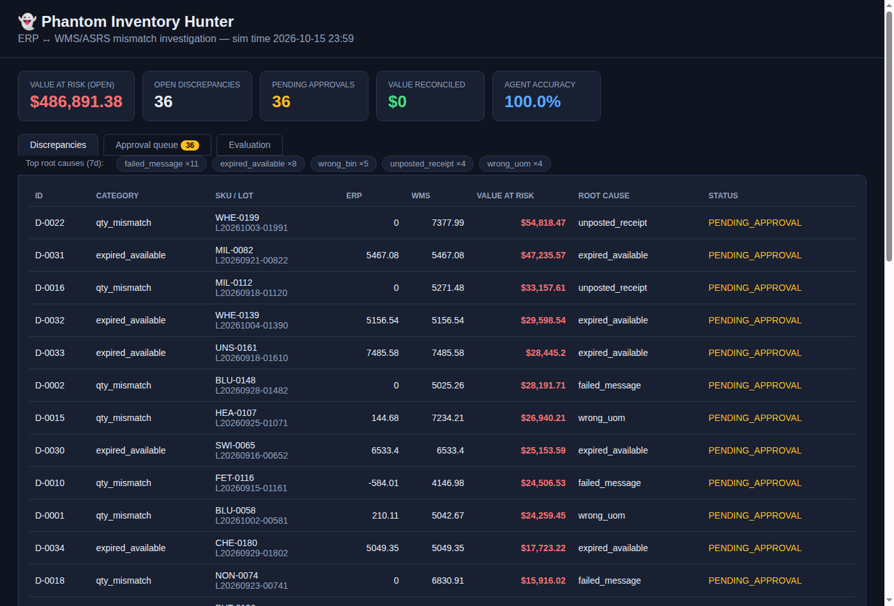
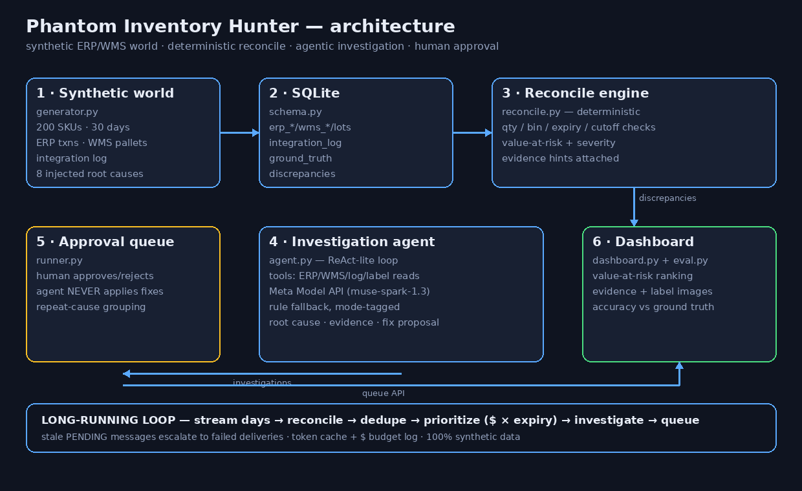

# 👻 Phantom Inventory Hunter

A long-running AI agent that finds and **explains** inventory mismatches between
an ERP system (think Microsoft Dynamics 365) and a WMS driving an automated
storage & retrieval system (think Mecalux-style ASRS).

Built for the **Meta Global AI Developer Hackathon** (Oct 26 – Nov 4, 2026) —
$1M prize pool, indie-dev track.

In food & dairy manufacturing, the ERP and the WMS each keep their own
inventory records. They drift apart through failed integration messages,
duplicate postings, wrong units of measure, mislabeled pallets, and timing
gaps. Analysts trace each mismatch by hand — hours per case. This agent does
the investigation automatically, proposes the fix, and **never applies anything
itself**: every fix waits in a human approval queue.

> **100% synthetic data.** No real company data anywhere, by design.



## The 3-minute demo

```bash
make setup && make showcase
```

The dramatic catch: the ERP thinks **~$48,000** of Micellar Casein is available.
It expired yesterday, sitting in **rack 14**. Watch the engine flag it, the
agent build the evidence trail, and the fix land in the approval queue:

```
[0:45] ACT 2 — reconcile. The engine flags what the ERP can't see.
  D-0035: expired_available — MIC-0113 L20260715-0113SC
  ERP says: 4,379.56 AVAILABLE   WMS says: 4,379.56 in rack 14
  Value at risk: $47,999.98  (severity: high)
```

Then explore it live:

```bash
python -m phantom_hunter.dashboard --db data/showcase.db --port 8000
```

## Quickstart

```bash
make setup      # venv + deps (pillow, pytest only)
make data       # generate the synthetic world
make demo       # reconcile + print the mismatch summary
make agent      # investigate 10 samples, print evidence trails
make loop       # 3 simulated days: stream → reconcile → investigate → queue
make dashboard  # web UI at http://127.0.0.1:8000
make showcase   # the scripted 3-minute demo
make test       # full test suite (53 tests)
```

Set `META_MODEL_API_KEY` to investigate with the Meta Model API
(`muse-spark-1.3`); without it the agent runs a deterministic rule-based
fallback and every result is tagged `mode: fallback`.

## How it works



1. **Synthetic world** (`generator.py`) — 200 SKUs × 30 days of ERP
   transactions, WMS pallets/bins, and an integration message log, built
   consistent, then injected with 8 known root-cause types (failed/duplicate
   messages, unposted receipts, wrong UOM, wrong bin, expired lots, cutoff
   gaps, contradicting pallet labels), each with ground-truth labels.
2. **Reconcile engine** (`reconcile.py`) — deterministic; flags every
   SKU/lot/location mismatch with quantities, value at risk, and severity.
   The engine never guesses causes — that's the agent's job.
3. **Investigation agent** (`agent.py` + `tools.py` + `llm.py`) — ReAct-lite
   loop over read-only tools (ERP/WMS queries, integration-log search,
   pallet-label images). Outputs root cause, confidence, evidence trail,
   and a proposed fix. Small model for routine cases, larger for hard ones;
   responses cached, tokens + spend logged (budget: $150 — demo spend: $0).
4. **Long-running loop** (`runner.py`) — streams new simulated days,
   re-reconciles, dedupes, prioritizes by **$ × expiry risk**, groups repeat
   root causes, files everything in the approval queue. Stale PENDING
   messages escalate to failed deliveries on their own.
5. **Dashboard + evaluation** (`dashboard.py`, `eval.py`) — discrepancy
   ranking, evidence + label images, approve/reject, and root-cause
   accuracy vs ground truth (100% on the reference run).

## Project layout

```
phantom_hunter/
  schema.py      SQLite DDL
  generator.py   synthetic world + discrepancy injection (+ streaming)
  labels.py      pallet-label image generator (PIL)
  reconcile.py   deterministic reconciliation engine
  llm.py         Meta Model API client (cache + token/cost logging)
  tools.py       read-only evidence tools
  agent.py       investigation agent
  runner.py      long-running loop + approval queue
  dashboard.py   web dashboard (stdlib HTTP server + JSON API)
  eval.py        accuracy vs injected ground truth
  showcase.py    scripted 3-minute demo
  static/        dashboard frontend
tests/           53 pytest tests
docs/            architecture diagram, dashboard screenshots, DECISIONS.md
```

Key design decisions live in [`DECISIONS.md`](DECISIONS.md) —
including the real bugs the test suite caught.

## Milestones

- **M1** ✅ Synthetic data generator + reconciliation engine, with unit tests
- **M2** ✅ Investigation agent with tools (10 sample discrepancies, console)
- **M3** ✅ Long-running loop + approval queue
- **M4** ✅ Dashboard + evaluation scores
- **M5** ✅ Polish: README, architecture diagram, scripted 3-minute demo

## License

MIT — see [LICENSE](LICENSE).
